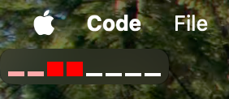
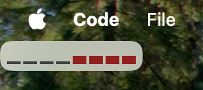

### `cpubeat`

A simple CPU monitoring widget for tray. This is NOT a widget for the sidebar panel.

### What it shows

1. Refreshes CPU info every second.
2. Only performance cores. Efficiency cores are always busy and they don't really drain battery.
3. Supports light and dark mode.
4. When idle (i.e. CPU isn't busy and UI of the widget doesn't update) consumes ~0.02% of CPU.
5. When load of every core changes every second (i.e. heavily but also randomly loaded workflow) it consumes ~0.3% of CPU.
6. Each secondary workspace shows a copy of a widget that has to be "copied" from the main workspace, with 6 total workspaces CPU usage varies from 0.04% (idle) to 1.2% (full re-render every second).

### Screenshots

### Installation

1. `brew install --cask iliabylich/cpubeat/cpubeat`
2. From the latest release
3. From sources: `git clone` + `mise //:release:dmg --version 0.0.1`

### Benchmarks

To benchmark the app pass an environment variable in the format `CPUBEAT_SYNTHETIC="flag=value,flag=value"` where flags are:

+ `syscall` - `0` or `1` - specifies whether the app should query for CPU data every second as it normally does. Designed specifically to benchmark speed of the data collection loop.
    + `0` means NO syscall
    + `1` means DO syscall
+ `ui` - `0` or `1` - specifies whether the data that is passed to UI should be fully rewritten to trigger a full re-render.
    + `0` replaces the data returned from a syscall with zeroes. Use this to emulate an "idle" state.
    + `1` replaces the data from a syscall with a constantly rotating sequence of increasing numbers (`0,1,2` -> `1,2,0` -> `2,0,1` -> `0,1,2`). Use this to emulate an "active" state when UI fully updates on every tick.

In other words:

+ `syscall=0,ui=0` means "do no work, only run the timer"
+ `syscall=1,ui=0` means "fetch the data, but don't bother updating UI"
+ `syscall=0,ui=1` means "just update full UI with some data"
+ `syscall=1,ui=1` means "fetch the data, but do a full render using fake data to update all the UI". This is literally the worst thing perf-wise that can happen to this app.

The default value for both flags is `"0"`. `mise //:synthetic --options "syscall=0,ui=1"` is a shortcut for running the app in a specific mode.

To run a benchmark do `mise //tools:bench --synthetic "syscall=0,ui=1" --seconds 10` (no syscall, full UI update, record for 10 seconds).

### License

MIT.

The icon is taken from [FlatIcon](https://www.flaticon.com/free-icon/low-speed_9097994) website.
